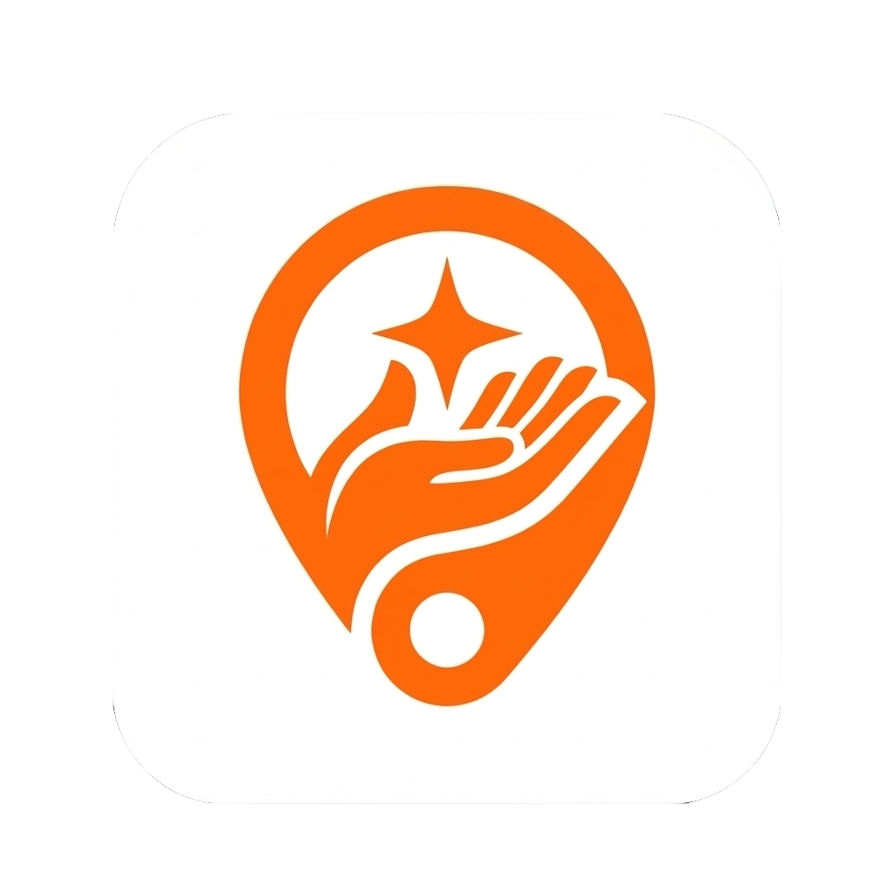
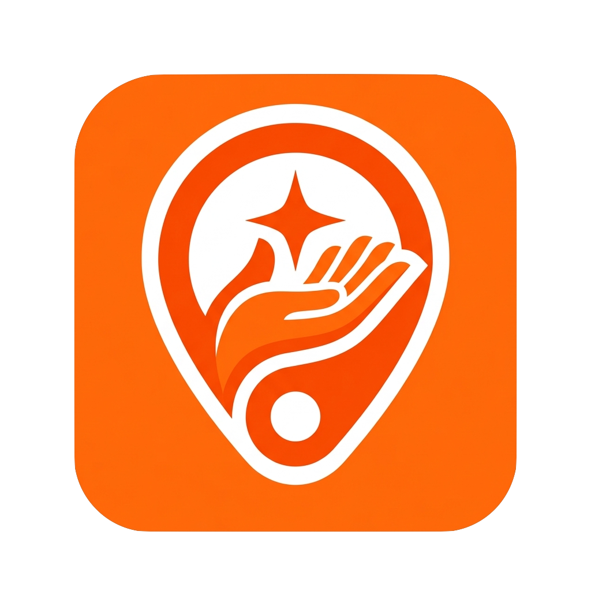
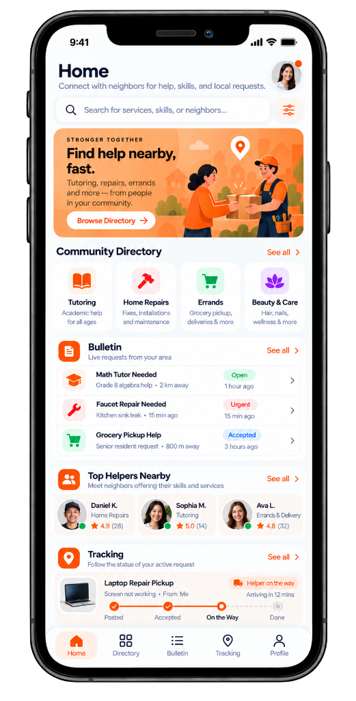
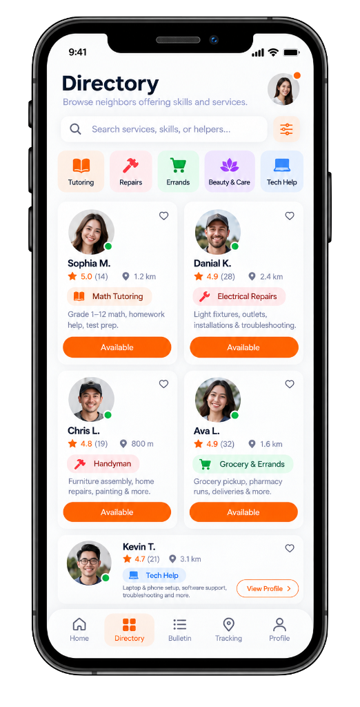
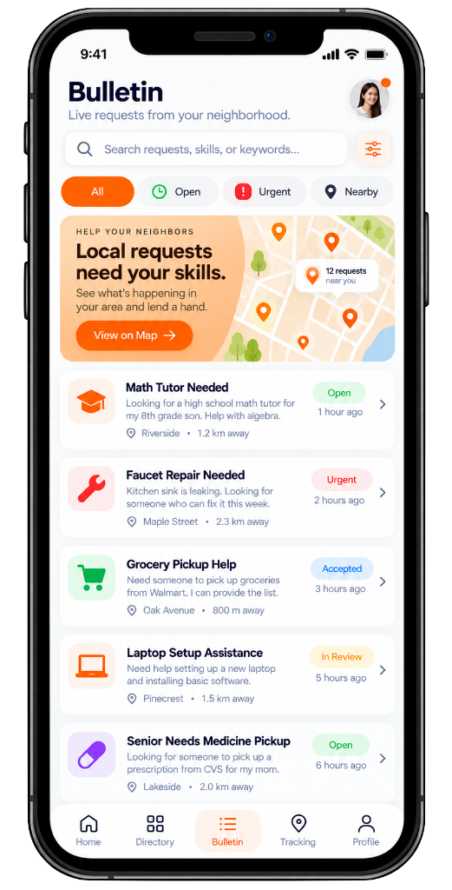
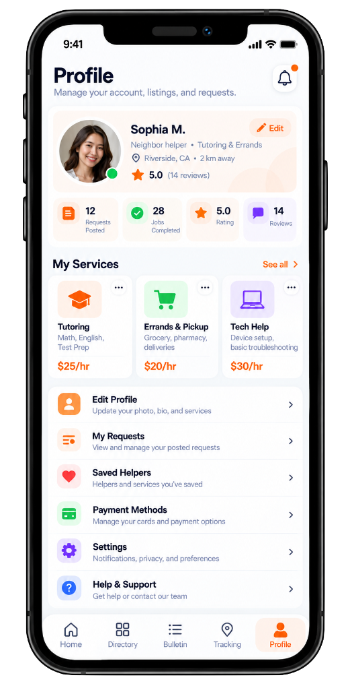
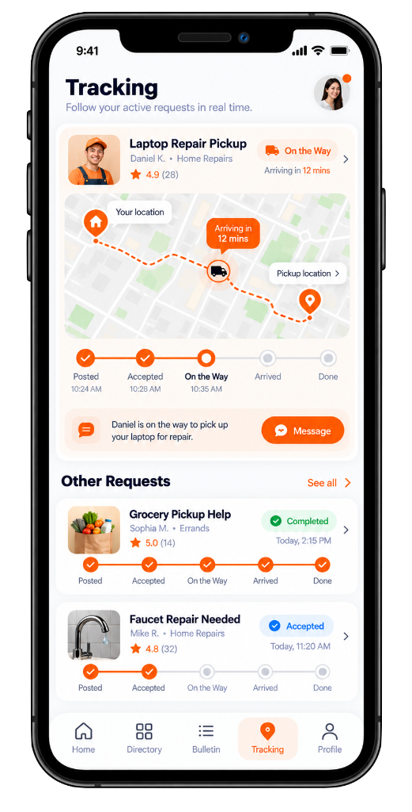

# 🎨 Master UI Screen Design & Asset Guide for Codex

> **INSTRUCTION FOR CODEX & AI DEVELOPERS:**  
> This document is the definitive visual and architectural reference for the mobile application. The five core screens have been fully designed and approved. High-resolution UI screen mockups are stored in:  
> - **Workspace UI Assets Path:** `file:///Users/mclein/Documents/Developer/Personal_Projects/SERVIO/assets/ui/`  
> - **Workspace Logo Assets Path:** `file:///Users/mclein/Documents/Developer/Personal_Projects/SERVIO/assets/logo/`  
> - **Vault UI & Brand Assets Path:** `file:///Users/mclein/Documents/Developer/Personal_Projects/SERVIO/vault/03_User_Experience_and_Screens/assets/`  
> 
> Build each screen, component, and layout strictly matching the visual hierarchies, colors, spacing, and component trees defined below.

---

## 🎨 Global Design System & Style Tokens

### Official Brand Logo & App Icon
- **Light Logo Asset:** `assets/logo/servio_logo_light.png` (`vault/03_User_Experience_and_Screens/assets/servio_logo_light.png`)
  - *Anatomy:* White squircle container with crisp boundary, featuring an orange location pin framing an open helping hand that supports a sparkling 4-point star.
- **Orange App Icon Asset:** `assets/logo/servio_app_icon_orange.png` (`vault/03_User_Experience_and_Screens/assets/servio_app_icon_orange.png`)
  - *Anatomy:* Vibrant solid brand orange squircle with white border location pin, framing an orange helping hand and sparkling service star.

 


### Color Palette
- **Primary Brand Orange:** `#FF5C00` / `#FF6B00` (Used for primary buttons, active tab indicators, highlighted hourly rates `$XX/hr`, and urgent tags).
- **Surface Background:** `#F8F9FA` / `#F5F6F8` (Ultra-clean off-white background).
- **Card Background:** `#FFFFFF` (Pure white containers with subtle shadow `BoxShadow(color: Colors.black.withOpacity(0.04), blurRadius: 16, offset: Offset(0, 4))`).
- **Corner Radii:**
  - Cards & Hero Containers: `BorderRadius.circular(24)` or `BorderRadius.circular(20)`
  - Buttons & Action Pills: `BorderRadius.circular(30)` (Full capsule / stadium shape)
  - Category Icon Squares: `BorderRadius.circular(16)`
- **Category Pastel Backgrounds:**
  - **Tutoring / Education:** Soft Orange (`#FFF2E8`, Icon `#FF6B00`)
  - **Home Repairs / Trades:** Soft Coral/Red (`#FFEBEB`, Icon `#EF4444`)
  - **Errands & Deliveries:** Soft Mint/Green (`#E8F8F0`, Icon `#10B981`)
  - **Beauty & Wellness:** Soft Purple (`#F5E8FF`, Icon `#A855F7`)
  - **Tech Help:** Soft Azure/Blue (`#E8F3FF`, Icon `#2563EB`)
- **Status Badge Tokens:**
  - `Open`: Background `#E8F8F0`, Text `#10B981`
  - `Urgent`: Background `#FEE8E8`, Text `#EF4444`
  - `Accepted` / `On the Way`: Background `#EBF5FF`, Text `#3B82F6`
  - `In Review`: Background `#FEF3C7`, Text `#D97706`
  - `Completed`: Background `#E8F8F0`, Text `#10B981`
- **Typography:**
  - Headlines: Bold sans-serif (`FontWeight.w700`), Deep Charcoal/Navy (`#111827`)
  - Subtitles & Body: Neutral Slate (`#64748B`), Regular (`FontWeight.w400`) & Medium (`FontWeight.w500`)
  - Prices: Bold Highlight (`#FF5C00`, `FontWeight.w700`)

---

## 📱 The 5 Core Application Screens

The application is structured around a persistent 5-tab **BottomNavigationBar**:
1. `Home` (`/home`)
2. `Directory` (`/directory`)
3. `Bulletin` (`/bulletin`)
4. `Tracking` (`/tracking`)
5. `Profile` (`/profile`)

```
+---------------------------------------------------------------------------------+
|                                 SERVIO APP TABS                                 |
|                                                                                 |
|   [ Home ]     [ Directory ]     [ Bulletin ]     [ Tracking ]     [ Profile ]  |
|   (/home)      (/directory)      (/bulletin)      (/tracking)      (/profile)   |
+---------------------------------------------------------------------------------+
```

---

### Screen 1: Home Screen (`/home`)
**Asset File:** `assets/ui/01_screen_home.png`  
**Vault Reference:** `assets/01_screen_home.png`



#### Purpose
The central storefront and neighborhood activity hub. Connects neighbors to browse categories, discover top-rated local helpers, check urgent bulletin posts, and glance at active request tracking.

#### Component Blueprint & Layout
1. **Header App Bar:**
   - Title: "Home" (Large bold)
   - Subtitle: "Connect with neighbors for help, skills, and local requests."
   - Right: Circular user avatar with active green/orange notification badge.
2. **Search Header:**
   - `TextField` with rounded border, search magnifying icon on left.
   - Placeholder: *"Search for services, skills, or neighbors..."*
   - Trailing filter slider icon button (`#FF5C00`).
3. **Hero Card ("STRONGER TOGETHER"):**
   - Rounded card with soft warm gradient background (Light Amber to Orange).
   - Illustration of two neighbors with a delivery box and repair tool belt.
   - Text: *"Find help nearby, fast. Tutoring, repairs, errands and more — from people in your community."*
   - CTA: White pill button `[ Browse Directory -> ]`.
4. **Community Directory Section:**
   - Section header: "Community Directory" with trailing `See all >` orange link.
   - 4-item horizontal row / grid:
     - 📚 Tutoring: "Academic help for all ages"
     - 🔨 Home Repairs: "Fixes, installations and maintenance"
     - 🛒 Errands: "Grocery pickup, deliveries & more"
     - 🪷 Beauty & Care: "Hair, nails, wellness & more"
5. **Bulletin Section:**
   - Section header: "Bulletin" + subtitle "Live requests from your area" + `See all >`.
   - Card Feed:
     - Card 1: *Math Tutor Needed* (Grade 8 algebra help • 2 km away, `Open`, `1 hour ago`).
     - Card 2: *Faucet Repair Needed* (Kitchen sink leak • 15 min ago, `Urgent`, `15 min ago`).
     - Card 3: *Grocery Pickup Help* (Senior resident request • 800 m away, `Accepted`, `3 hours ago`).
6. **Top Helpers Nearby Section:**
   - Section header: "Top Helpers Nearby" + subtitle "Meet neighbors offering their skills and services" + `See all >`.
   - Horizontal list of helper cards with circular avatar, online dot, Name, Trade, and Star rating (e.g. *Daniel K. • Home Repairs ★ 4.9 (28)*).
7. **Tracking Mini-Widget:**
   - Section header: "Tracking" + subtitle "Follow the status of your active request" + `See all >`.
   - Active Request: *Laptop Repair Pickup* (From: Me, `Helper on the way`, `Arriving in 12 mins`).
   - 4-step horizontal progress line: `Posted (✓)` -> `Accepted (✓)` -> `On the Way (●)` -> `Done (○)`.

---

### Screen 2: Directory Screen (`/directory`)
**Asset File:** `assets/ui/02_screen_directory.png`  
**Vault Reference:** `assets/02_screen_directory.png`



#### Purpose
Browse and filter verified local skilled neighbors and service providers with availability status, distance, and direct profile booking.

#### Component Blueprint & Layout
1. **Header App Bar:**
   - Title: "Directory" (Large bold)
   - Subtitle: "Browse neighbors offering skills and services."
   - Right: Circular user profile avatar.
2. **Search & Filter Row:**
   - Search input: *"Search services, skills, or helpers..."* + Filter settings button.
3. **Category Filter Chips (Horizontal ListView):**
   - Category chips with pastel icon backgrounds: `[ Tutoring ]`, `[ Repairs ]`, `[ Errands ]`, `[ Beauty & Care ]`, `[ Tech Help ]`.
4. **2-Column Helper Card Grid:**
   - Card anatomy:
     - Top-right favorite heart icon (`IconButton`).
     - Center: Large circular avatar with online green status dot.
     - Name: Bold headline (e.g. *Sophia M.*, *Danial K.*, *Chris L.*, *Ava L.*).
     - Rating & Distance: Star icon + score + reviews count + distance pin (e.g. `★ 5.0 (14)  📍 1.2 km`).
     - Trade Badge: Rounded pastel pill with icon (e.g. `📖 Math Tutoring`, `⚡ Electrical Repairs`, `🔨 Handyman`).
     - Short Bio Snippet: Text preview of skills (e.g. *"Grade 1–12 math, homework help, test prep."*).
     - Action Button: Full-width brand orange pill button `[ Available ]` or `[ View Profile > ]`.

---

### Screen 3: Bulletin Screen (`/bulletin`)
**Asset File:** `assets/ui/03_screen_bulletin.png`  
**Vault Reference:** `assets/03_screen_bulletin.png`



#### Purpose
The hyper-local neighborhood request board where users can view live service requests, filter by urgency/proximity, and lend a hand to neighbors.

#### Component Blueprint & Layout
1. **Header App Bar:**
   - Title: "Bulletin" (Large bold)
   - Subtitle: "Live requests from your neighborhood."
   - Right: User avatar with notification badge.
2. **Search & Filter Tabs:**
   - Search bar: *"Search requests, skills, or keywords..."* + filter button.
   - Filter Chips Row:
     - `[ All ]` (Selected solid orange pill)
     - `[ Open ]` (Mint green dot & text)
     - `[ ! Urgent ]` (Red exclamation & text)
     - `[ Nearby ]` (Location pin & text)
3. **Hero Map Banner ("HELP YOUR NEIGHBORS"):**
   - Illustrated map snippet displaying pin clusters (e.g., "12 requests near you").
   - Headline: *"Local requests need your skills. See what's happening in your area and lend a hand."*
   - CTA: `[ View on Map -> ]` (Orange pill button).
4. **Live Request Cards Feed (Vertical ListView):**
   - Each item card displays:
     - Left: Square rounded pastel container with trade icon (Graduation cap, Wrench, Cart, Laptop, Medicine pill).
     - Center Content:
       - Title: Bold (e.g. *"Math Tutor Needed"*, *"Faucet Repair Needed"*, *"Grocery Pickup Help"*).
       - Description: Body text snippet describing specific need.
       - Subtitle: Location address + distance (e.g. *"Riverside • 1.2 km away"*, *"Maple Street • 2.3 km away"*).
     - Right Meta:
       - Status badge: `Open`, `Urgent`, `Accepted`, `In Review`.
       - Timestamp: `1 hour ago`, `15 min ago`, `3 hours ago`.
       - Trailing chevron `>` (Navigates to Request Detail / Proposal screen).

---

### Screen 4: Profile Screen (`/profile`)
**Asset File:** `assets/ui/04_screen_profile.png`  
**Vault Reference:** `assets/04_screen_profile.png`



#### Purpose
Unified dual-role profile dashboard allowing users to seamlessly transition between posting requests as a customer and offering skills/services as a paid helper.

#### Component Blueprint & Layout
1. **Header App Bar:**
   - Title: "Profile"
   - Subtitle: "Manage your account, listings, and requests."
   - Right: Notification bell with unread orange dot.
2. **User Hero Profile Card:**
   - Large avatar with green active status dot.
   - Edit button: `[ ✏️ Edit ]` (Orange outline chip).
   - Full Name: *Sophia M.*
   - Bio / Subtitle: *"Neighbor helper • Tutoring & Errands"*
   - Location: *"Riverside, CA • 2 km away"*
   - Rating: `★ 5.0 (14 reviews)`
3. **4-Metric Stats Row:**
   - 4 equal-width rounded cards:
     - 📄 **12** Requests Posted
     - ✅ **28** Jobs Completed
     - ⭐ **5.0** Rating
     - 💬 **14** Reviews
4. **"My Services" Skills Showcase Section:**
   - Section header: "My Services" + `See all >`.
   - Horizontal card list showing services the user provides:
     - Card 1: 🎓 Tutoring (Math, English, Test Prep) — Bold orange price: **`$25/hr`** + 3-dot options menu.
     - Card 2: 🛒 Errands & Pickup (Grocery, pharmacy, deliveries) — **`$20/hr`** + 3-dot options menu.
     - Card 3: 💻 Tech Help (Device setup, basic troubleshooting) — **`$30/hr`** + 3-dot options menu.
5. **Account Management Navigation List:**
   - List items with icons, descriptive subtext, and chevrons:
     - 👤 **Edit Profile**: Update your photo, bio, and services
     - 📑 **My Requests**: View and manage your posted requests
     - ❤️ **Saved Helpers**: Helpers and services you've saved
     - 💳 **Payment Methods**: Manage your cards and payment options
     - ⚙️ **Settings**: Notifications, privacy, and preferences
     - ❓ **Help & Support**: Get help or contact our team

---

### Screen 5: Tracking Screen (`/tracking`)
**Asset File:** `assets/ui/05_screen_tracking.png`  
**Vault Reference:** `assets/05_screen_tracking.png`



#### Purpose
Real-time GPS order execution and delivery tracking (Foodpanda-style), with live map route polylines, milestone steppers, and direct helper messaging.

#### Component Blueprint & Layout
1. **Header App Bar:**
   - Title: "Tracking"
   - Subtitle: "Follow your active requests in real time."
   - Right: User avatar with notification dot.
2. **Hero Active Request Card:**
   - Helper info row:
     - Thumbnail photo + Name: *Daniel K. • Home Repairs (★ 4.9 (28))*.
     - Request Title: *Laptop Repair Pickup*.
     - Status Badge: `Helper on the way` (Orange van icon) + `Arriving in 12 mins` + chevron.
   - **Embedded Interactive Map Snippet:**
     - Origin marker: "Pickup location"
     - Destination marker: "Your location"
     - Dashed orange route polyline
     - Animated helper vehicle marker with dynamic ETA bubble: *"Arriving in 12 mins"*
   - **5-Stage Horizontal Progress Stepper:**
     - Stage 1: `Posted` (10:24 AM) — Checked orange circle
     - Stage 2: `Accepted` (10:28 AM) — Checked orange circle
     - Stage 3: `On the Way` (10:35 AM) — Active orange filled dot
     - Stage 4: `Arrived` — Inactive gray circle
     - Stage 5: `Done` — Inactive gray circle
   - **Direct In-App Communication Banner:**
     - Orange speech bubble: *"Daniel is on the way to pick up your laptop for repair."*
     - Quick Action Button: `[ 💬 Message ]` (Orange pill button navigating directly to order chat).
3. **"Other Requests" Section:**
   - Section header: "Other Requests" + `See all >`.
   - Card 1: *Grocery Pickup Help* (Sophia M. • Errands ★ 5.0 (14), `Completed` green tag, `Today, 2:15 PM`, 5-step stepper all checked).
   - Card 2: *Faucet Repair Needed* (Mike R. • Home Repairs ★ 4.8 (32), `Accepted` blue tag, `Today, 11:20 AM`, stepper with first 2 stages checked).

---

## 🛠️ Pure Ionic-Angular Framework Architecture & SCSS Guide for Codex

Codex must develop the application purely with the **Ionic-Angular framework (`@ionic/angular`)** using **HTML** templates and **SCSS** styling. Do NOT use Flutter or other web frameworks.

### 1. Directory Structure Blueprint
```
src/
├── app/
│   ├── core/
│   │   ├── services/                 # BookingService, TrackingService, AuthService
│   │   └── models/                   # RequestItem, Helper, OrderState
│   ├── shared/
│   │   └── components/
│   │       ├── search-filter-bar/    # Reusable search bar with orange filter icon
│   │       ├── status-badge/         # Open, Urgent, Accepted, On the Way badges
│   │       ├── order-stepper/        # 5-stage horizontal milestone progress stepper
│   │       └── helper-card/          # 2-column grid helper card
│   ├── tabs/
│   │   ├── tabs.page.html            # ion-tabs with 5 ion-tab-button elements
│   │   ├── tabs.page.scss            # Custom tab bar styling & active indicator
│   │   ├── tabs.page.ts
│   │   └── tabs.routes.ts            # Angular standalone child route definitions
│   └── pages/
│       ├── home/
│       │   ├── home.page.html        # Hero promo card, category grid, live snippets
│       │   ├── home.page.scss        # Scoped SCSS for home feed
│       │   └── home.page.ts
│       ├── directory/
│       │   ├── directory.page.html   # Category filter chips & 2-column helper grid
│       │   ├── directory.page.scss
│       │   └── directory.page.ts
│       ├── bulletin/
│       │   ├── bulletin.page.html    # Urgency pills, hero map card, vertical requests feed
│       │   ├── bulletin.page.scss
│       │   └── bulletin.page.ts
│       ├── tracking/
│       │   ├── tracking.page.html    # Active request card, map view, stepper, chat CTA
│       │   ├── tracking.page.scss
│       │   └── tracking.page.ts
│       └── profile/
│           ├── profile.page.html     # User hero, 4 stats badges, "My Services" cards
│           ├── profile.page.scss
│           └── profile.page.ts
└── theme/
    ├── variables.scss                # Brand colors, typography, pastel map variables
    └── global.scss                   # Global card shadows, border-radii, utilities
```

### 2. SCSS Design Tokens (`src/theme/variables.scss`)
```scss
// Brand Palette
$brand-orange: #FF5C00;
$brand-orange-hover: #E05200;
$brand-orange-light: #FFF2E8;

// Neutral Surfaces
$surface-bg: #F8F9FA;
$card-bg: #FFFFFF;
$text-main: #111827;
$text-muted: #64748B;
$border-light: #E2E8F0;

// Category Pastels
$cat-tutoring-bg: #FFF2E8;
$cat-tutoring-icon: #FF5C00;
$cat-repairs-bg: #FFEBEB;
$cat-repairs-icon: #EF4444;
$cat-errands-bg: #E8F8F0;
$cat-errands-icon: #10B981;
$cat-beauty-bg: #F5E8FF;
$cat-beauty-icon: #A855F7;
$cat-tech-bg: #E8F3FF;
$cat-tech-icon: #2563EB;

// Card Mixin
@mixin servio-card {
  background: $card-bg;
  border-radius: 20px;
  box-shadow: 0 4px 16px rgba(0, 0, 0, 0.04);
  border: 1px solid rgba(0, 0, 0, 0.03);
}

// Capsule Pill Mixin
@mixin capsule-btn {
  border-radius: 9999px;
  font-weight: 600;
  text-transform: none;
}
```

### 3. Ionic Tabs HTML Template Blueprint (`src/app/tabs/tabs.page.html`)
```html
<ion-tabs>
  <ion-tab-bar slot="bottom" class="servio-tab-bar">
    <ion-tab-button tab="home">
      <ion-icon name="home-outline"></ion-icon>
      <ion-label>Home</ion-label>
    </ion-tab-button>

    <ion-tab-button tab="directory">
      <ion-icon name="grid-outline"></ion-icon>
      <ion-label>Directory</ion-label>
    </ion-tab-button>

    <ion-tab-button tab="bulletin">
      <ion-icon name="list-outline"></ion-icon>
      <ion-label>Bulletin</ion-label>
    </ion-tab-button>

    <ion-tab-button tab="tracking">
      <ion-icon name="location-outline"></ion-icon>
      <ion-label>Tracking</ion-label>
    </ion-tab-button>

    <ion-tab-button tab="profile">
      <ion-icon name="person-outline"></ion-icon>
      <ion-label>Profile</ion-label>
    </ion-tab-button>
  </ion-tab-bar>
</ion-tabs>
```

---

## 🔗 Related Notes
- [[Screen_Inventory]] — Complete screen index.
- [[Customer_Journey_Map]] — End-to-end user experience flow.
- [[Order_Lifecycle_State_Machine]] — Status transition logic for the Tracking stepper.
- [[Domain_Model]] — Data models backing these screens.
- [[MOC_Servio]] — Back to Master Map of Content.
