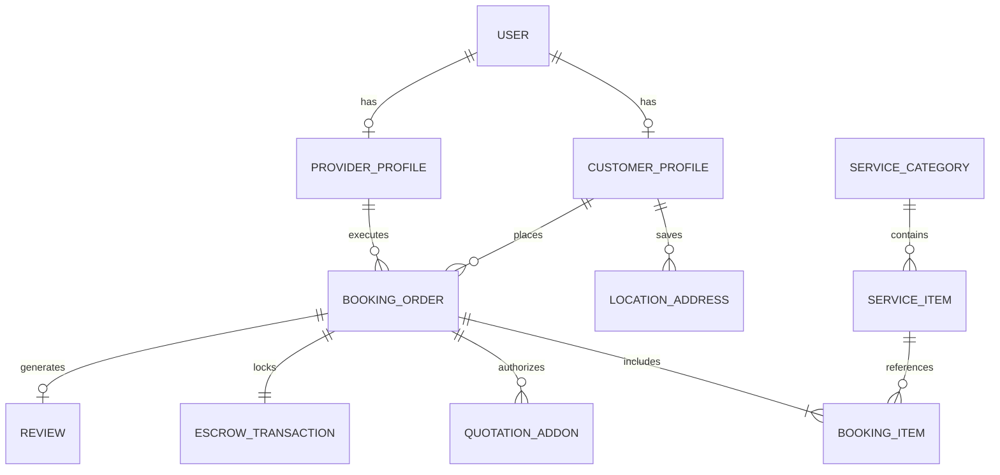

# 🏛️ Domain Model & Entity Architecture

The SERVIO platform domain model enforces transactional integrity, strict relational consistency between service catalogs and booking executions, and immutable escrow financial tracking.

---

## 1. Entity-Relationship Diagram (ERD)

---

## 2. Core Entity Definitions

### 2.1 User & Profiles
- **`User`**: Base authentication entity (shared across Customer and Pro).
  - `id`: UUID (PK)
  - `phone`: VARCHAR(20) (Unique, Indexed)
  - `email`: VARCHAR(255) (Nullable)
  - `role`: ENUM (`CUSTOMER`, `PROVIDER`, `ADMIN`)
  - `created_at`, `updated_at`: TIMESTAMP

- **`CustomerProfile`**:
  - `id`: UUID (PK)
  - `user_id`: UUID (FK -> User.id)
  - `full_name`: VARCHAR(100)
  - `avatar_url`: TEXT
  - `default_address_id`: UUID (FK -> LocationAddress.id)

- **`ProviderProfile`**:
  - `id`: UUID (PK)
  - `user_id`: UUID (FK -> User.id)
  - `trade_categories`: TEXT[] (e.g. `['HVAC', 'PLUMBING']`)
  - `kyc_status`: ENUM (`UNSUBMITTED`, `PENDING_REVIEW`, `APPROVED`, `REJECTED`)
  - `is_online`: BOOLEAN (Default: `false`)
  - `current_latitude`, `current_longitude`: DOUBLE PRECISION (PostGIS Geometry point)
  - `last_location_ping_at`: TIMESTAMP
  - `rating_average`: NUMERIC(3, 2) (Default: `5.00`)
  - `rating_count`: INTEGER (Default: `0`)
  - `wallet_balance`: NUMERIC(12, 2) (Default: `0.00`)

### 2.2 Catalog & Standardized SKUs
- **`ServiceCategory`**:
  - `id`: UUID (PK)
  - `slug`: VARCHAR(50) (Unique)
  - `name`: VARCHAR(100) (e.g. "Air Conditioning")
  - `icon_url`: TEXT
  - `display_order`: INTEGER

- **`ServiceItem` (The Standardized SKU)**:
  - `id`: UUID (PK)
  - `category_id`: UUID (FK -> ServiceCategory.id)
  - `title`: VARCHAR(150) (e.g. "AC Cleaning — Split Inverter (1.0-1.5 HP)")
  - `base_customer_price`: NUMERIC(10, 2)
  - `standard_pro_payout`: NUMERIC(10, 2)
  - `platform_commission`: NUMERIC(10, 2)
  - `estimated_duration_minutes`: INTEGER
  - `inclusions`: JSONB (Array of string checklist items)
  - `exclusions`: JSONB (Array of string boundary items)
  - `is_active`: BOOLEAN (Default: `true`)

### 2.3 Order Execution & Add-ons
- **`BookingOrder`**:
  - `id`: UUID (PK)
  - `order_number`: VARCHAR(20) (Unique human-readable, e.g. `SRV-2026-8941`)
  - `customer_id`: UUID (FK -> CustomerProfile.id)
  - `assigned_provider_id`: UUID (Nullable, FK -> ProviderProfile.id)
  - `status`: ENUM (`DRAFT`, `SEARCHING_PRO`, `ACCEPTED`, `EN_ROUTE`, `ARRIVED`, `IN_PROGRESS`, `COMPLETED`, `CANCELLED`, `DISPUTED`)
  - `dispatch_mode`: ENUM (`INSTANT`, `SCHEDULED`)
  - `scheduled_start_time`: TIMESTAMP (Nullable)
  - `service_address_json`: JSONB (Snapshot of address, coordinates, and notes)
  - `completion_otp_hash`: VARCHAR(255) (Hashed 4-digit code generated for customer)
  - `base_amount`: NUMERIC(10, 2)
  - `addons_amount`: NUMERIC(10, 2) (Default: `0.00`)
  - `platform_fee`: NUMERIC(10, 2)
  - `total_customer_charged`: NUMERIC(10, 2)
  - `created_at`, `accepted_at`, `arrived_at`, `completed_at`: TIMESTAMP

- **`QuotationAddon`**:
  - `id`: UUID (PK)
  - `booking_id`: UUID (FK -> BookingOrder.id)
  - `title`: VARCHAR(150) (e.g. "Replacement Capacitor 45uF")
  - `description`: TEXT
  - `photo_evidence_url`: TEXT (Mandatory proof)
  - `price_added`: NUMERIC(10, 2)
  - `status`: ENUM (`PENDING_APPROVAL`, `APPROVED`, `DECLINED`)
  - `decided_at`: TIMESTAMP

### 2.4 Financials & Escrow
- **`EscrowTransaction`**:
  - `id`: UUID (PK)
  - `booking_id`: UUID (FK -> BookingOrder.id)
  - `state`: ENUM (`HOLD_AUTHORIZED`, `RELEASED_TO_PROVIDER`, `REFUNDED_TO_CUSTOMER`, `DISPUTED_LOCKED`)
  - `payment_gateway_charge_id`: VARCHAR(255)
  - `amount_held`: NUMERIC(12, 2)
  - `released_at`: TIMESTAMP

---

## 🔗 Related Notes
- [[Order_Lifecycle_State_Machine]] — How these entities change states.
- [[Security_and_Trust_Model]] — Financial integrity and data security.
- [[Screen_Specs_Customer]] — Front-end representation of entities.
- [[MOC_Servio]] — Back to Master Map of Content.
