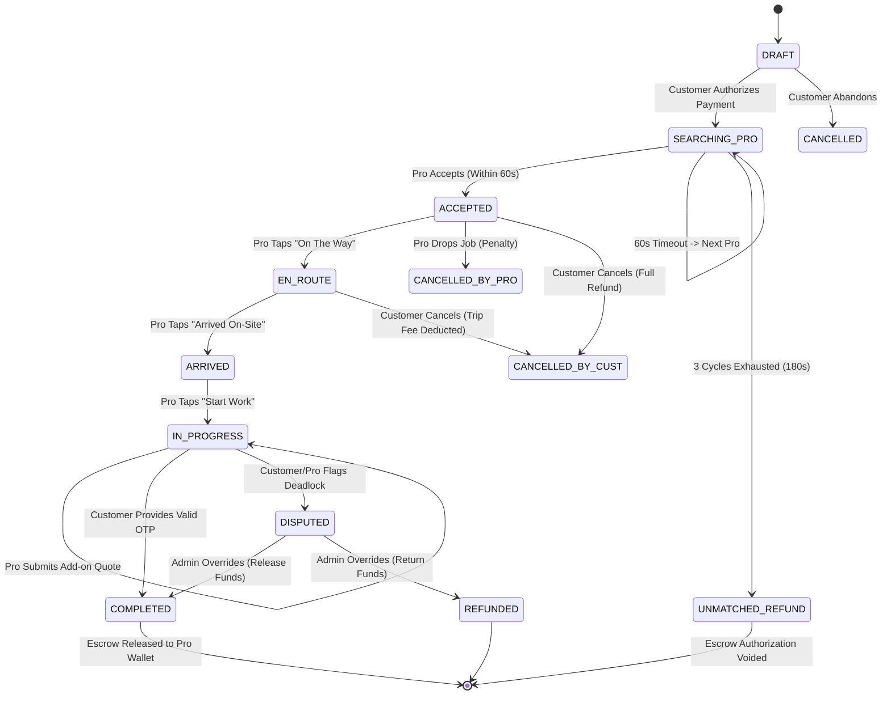

# ⚙️ Order Lifecycle State Machine

The SERVIO booking engine operates as a strictly deterministic finite state machine (FSM). Every transition requires an explicit actor trigger or an automated timeout condition, guaranteeing that funds in escrow are never trapped or lost.

---

## 1. State Diagram

---

## 2. State Transition Table & Financial Actions

| From State | To State | Trigger Actor | Pre-Conditions | Escrow / Financial Action |
| :--- | :--- | :--- | :--- | :--- |
| `DRAFT` | `SEARCHING_PRO` | Customer | Valid payment method & address | **Pre-Authorize Escrow** (Holds `$Total` on customer card/wallet). |
| `SEARCHING_PRO` | `ACCEPTED` | Service Pro | Pro has valid KYC & active online status | Escrow remains locked on platform. |
| `SEARCHING_PRO` | `UNMATCHED_REFUND`| System (Timeout)| 3 dispatch cycles (180s) fail to match | **Void Authorization** (100% refund, no charges). |
| `ACCEPTED` | `EN_ROUTE` | Service Pro | Pro within operational hours | Escrow remains locked. Live GPS tracking enabled. |
| `ACCEPTED` | `CANCELLED_BY_CUST`| Customer | Prior to Pro setting `EN_ROUTE` | **100% Full Refund** to customer. |
| `EN_ROUTE` | `ARRIVED` | Service Pro | GPS coordinates match address geofence | Escrow remains locked. |
| `EN_ROUTE` | `CANCELLED_BY_CUST`| Customer | Pro is already traveling on-site | **Trip Compensation Fee** (e.g. $10) charged to customer & credited to Pro. Remainder refunded. |
| `ARRIVED` | `IN_PROGRESS` | Service Pro | Pro verified customer site access | Job timer started. Escrow remains locked. |
| `IN_PROGRESS` | `IN_PROGRESS` | Customer | Add-on requested by Pro with photo | **Adjust Escrow Authorization** (Adds `+$Addon` to escrow hold). |
| `IN_PROGRESS` | `COMPLETED` | Service Pro + Cust| Pro enters matching Customer 4-digit OTP | **Release Escrow Immediately**: Pro Wallet credited (85%), Platform Commission retained (15%). |
| `IN_PROGRESS` | `DISPUTED` | Customer / Pro | Unresolvable conflict or damage claim | **Lock Escrow in Dispute Pool**: Requires Admin manual intervention. |
| `DISPUTED` | `REFUNDED` | Admin | Review proves provider fault or no-show | **Refund Escrow** back to customer. |

---

## 3. The Completion OTP Contract

1. When order transitions to `IN_PROGRESS`, the backend generates a cryptographically secure random 4-digit number:
   $$OTP \in [1000, 9999]$$
2. The OTP hash is stored in `BookingOrder.completion_otp_hash`.
3. The plain-text OTP is **ONLY** delivered to the Customer App (`CUST-14`). It is never sent to the Provider App.
4. When the technician completes the service, the technician prompts the customer for the code and enters it in `PRO-08`.
5. The backend checks:
   `verifyHash(input_otp, booking.completion_otp_hash)`
6. If valid:
   - Status transitions to `COMPLETED`.
   - Escrow is unlocked and credited to technician's wallet.
   - Warranty timer starts (30 days).
   - If invalid after 3 attempts: Enters rate-limit backoff (prevents brute forcing).

---

## 🔗 Related Notes
- [[Domain_Model]] — Entity definitions.
- [[Security_and_Trust_Model]] — Trust and anti-fraud protocols.
- [[Screen_Specs_Customer]] — Customer interfaces.
- [[Screen_Specs_Provider]] — Provider interfaces.
- [[MOC_Servio]] — Back to Master Map of Content.
